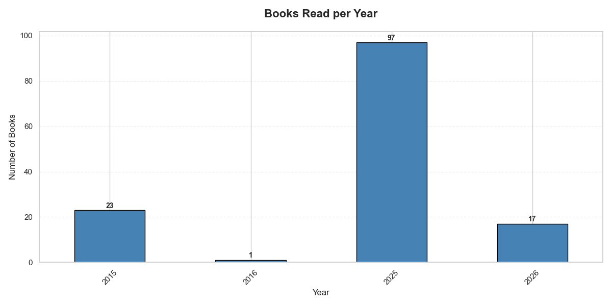
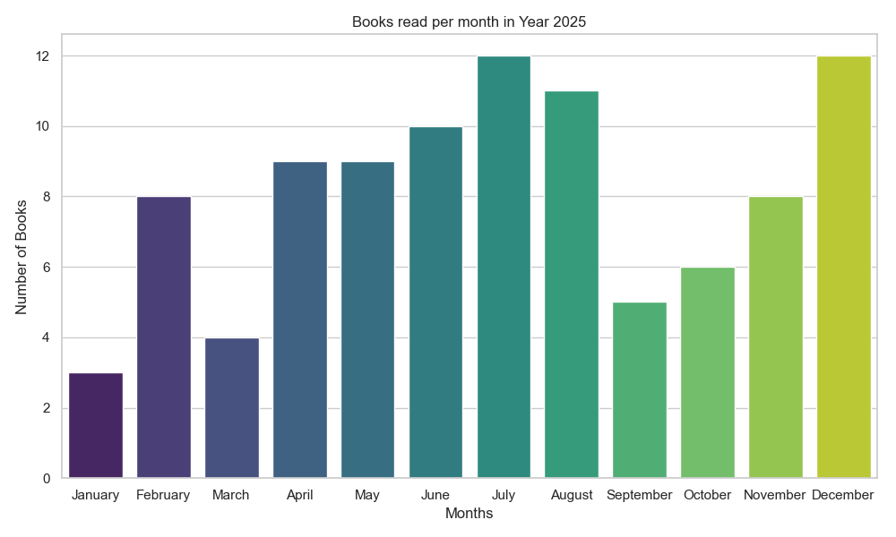
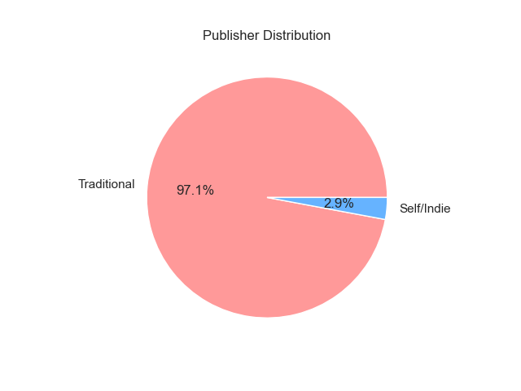
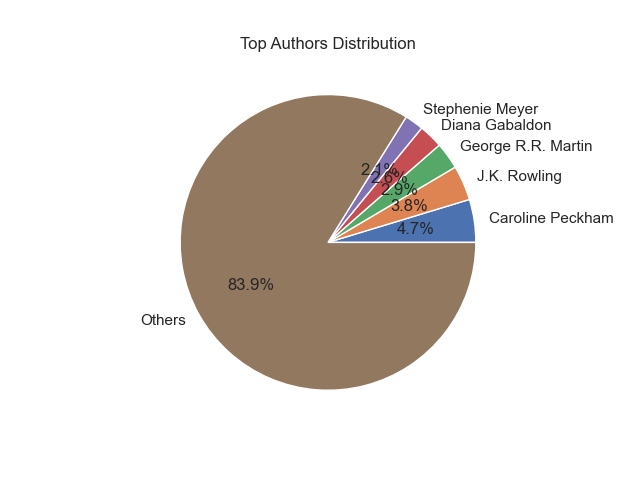

#  Goodreads Datenanalyse

##  Projektübersicht
Dieses Projekt analysiert persönliche Goodreads-Lesedaten, um Muster im Leseverhalten, Bewertungsverhalten und bei Autorenpräferenzen zu erkennen.

Ziel dieses Projekts ist es, Datenanalysetechniken mit Python anzuwenden und die gewonnenen Erkenntnisse klar und verständlich zu visualisieren.

---

##  Datenbereinigung & Vorbereitung
- Datumswerte in das richtige Datumsformat umgewandelt
- "Jahr" und "Monat" aus den Lesedaten extrahiert
- Fehlende Werte behandelt (z. B. Publisher → als "Self Published" markiert)
- Daten für gezielte Analysen gefiltert (z. B. Bücher aus dem Jahr 2025)

---

##  Analysen

###  Leseverhalten über die Zeit
- Anzahl gelesener Bücher pro Jahr analysiert
- 2025 als aktivstes Lesejahr identifiziert

###  Monatliche Lesemuster (2025)
- Visualisierung der Leseaktivität pro Monat
- Schwankungen und Spitzen im Leseverhalten erkannt

###  Bewertungsanalyse
- Eigene Bewertungen mit durchschnittlichen Goodreads-Bewertungen verglichen
- Ähnlichkeiten mit allgemeinen Nutzerbewertungen festgestellt

###  Autorenanalyse
- Am häufigsten gelesene Autoren identifiziert
- Präferenzen im Leseverhalten aufgezeigt

###  Verlagsanalyse
- Fehlende Verlagsdaten untersucht
- Unbekannte Einträge als "Self Published" klassifiziert

---

##  Beispiel-Visualisierungen

###  Gelesene Bücher pro Jahr

###  Gelesene Bücher pro Monat im Jahr 2025

###  Verlagsverteilung

###  Bewertung vs. Durchschnittsbewertung
[ Interaktive Version anzeigen](Charts/Rating_vs_Avg.html)

###  Top-Autoren

---

##  Wichtige Erkenntnisse
- Die Leseaktivität ist im Jahr 2025 deutlich gestiegen
- Das Leseverhalten variiert je nach Monat
- Eigene Bewertungen stimmen größtenteils mit Durchschnittswerten überein
- Ein Teil der Bücher ist selbst veröffentlicht
- Bestimmte Autoren werden häufiger gelesen

---

##  Technologien
- Python
- Pandas
- Matplotlib
- Seaborn
- Plotly

---

##  Zukünftige Verbesserungen
- Analyse nach Genres
- Entwicklung eines Empfehlungssystems
- Erweiterte statistische Analysen

---

##  Fazit
Dieses Projekt zeigt praktische Fähigkeiten in der Datenanalyse, einschließlich Datenbereinigung, Visualisierung und Interpretation von Ergebnissen. Es demonstriert, wie persönliche Daten genutzt werden können, um aussagekräftige Erkenntnisse zu gewinnen.